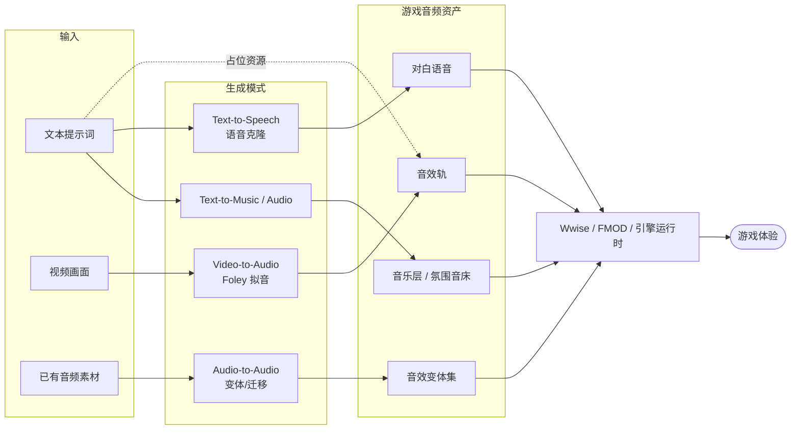
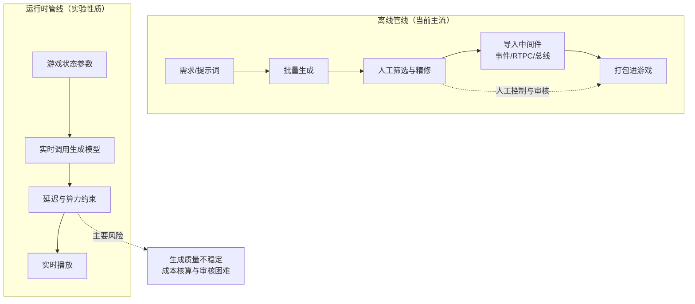
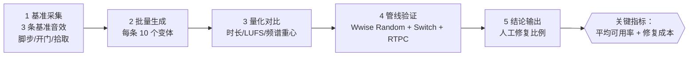

# 当下 AIGC 在游戏音频设计中的应用 · 调研报告

> **课程**：2026 SHU 基础实践 · 平时作业 Task
> **主题**：当下 AIGC 在游戏音频设计中的应用
> **资料检索时间**：2026 年 10 月
> **文档版本**：v1.0

---

## 摘要

AIGC（AI Generated Content）在游戏音频领域已经不再是"能不能用"的问题，而是"用在哪一环、以什么身份用"的问题。本报告从游戏音频设计的实际工作流出发，把 AIGC 的介入方式拆成两条轴：

- **按内容方向（做什么）**：Voice（人声/配音）、Music（音乐）、SFX（音效）；
- **按生成模式（怎么生成）**：Text-to-Audio / Text-to-Music、Text-to-Speech 与语音克隆、Text-to-Video（原生音频）与 Video-to-Audio（Foley 自动拟音）、Audio-to-Audio（风格迁移、分离、修复）。

调研的核心结论有三点：

1. **AIGC 目前最成熟的位置是"素材生产与变体爆炸"，而不是"最终艺术决策"。** 音效变体、占位资源（placeholder）、多语言本地化配音是投入产出比最高的三个落点。
2. **真正的工程价值出现在"运行时（runtime）"而不是"离线导出"。** 只有当生成结果能被 Wwise / FMOD / Unity / Unreal 的参数系统驱动，AIGC 才从"工具"变成"玩法的一部分"。
3. **最大的风险不是技术，而是权利与合规。** 训练数据来源、声音人格权（voice likeness）、平台披露要求，正在成为比模型效果更硬的约束条件。

---

## 1. 调研背景与方法

### 1.1 为什么游戏音频特别适合 AIGC

游戏音频与传统影视音频有一个结构性差异：**游戏音频是"被触发的"，并且需要"变化"。**

| 维度 | 影视音频 | 游戏音频 |
| --- | --- | --- |
| 播放方式 | 线性时间轴，一次终混 | 由玩家行为/状态触发，非线性 |
| 素材量 | 一条成品 | 同一事件往往需要大量变体以避免重复感 |
| 迭代方式 | 后期反复调 | 与玩法同步迭代，需求持续插入 |
| 时长成本 | 可控 | 内容量随玩法指数增长 |

"大量变体 + 持续迭代 + 需要大量占位资源"，恰好是生成模型最擅长的事情。这解释了为什么 AIGC 在游戏音频的落地速度，快于在传统音乐制作领域的落地速度。

### 1.2 调研方法与说明

本报告采用**公开资料调研 + 工作流分析**的方法：

- 公开资料来自模型/工具官方文档、行业博客与新闻报道（见第 9 节参考资料），检索时间为 2026 年 10 月；
- 报告中涉及的模型能力与产品状态均为**检索时点的公开信息**，AIGC 领域迭代极快，具体版本能力请以官方最新文档为准；
- 对存在争议或厂商澄清过的事实（如某游戏是否实际使用了 AI 配音），报告会同时标注"宣传口径"与"官方澄清"，不做单方面推断；
- 第 6 节的案例中，涉及版权与行业争议的部分只做事实转述与影响分析，不代表笔者对相关法律问题的判断。

---

## 2. 技术地图：四种生成模式

把 AIGC 的生成模式与游戏音频的资产类型做一次映射，可以得到下面这张"能力—用途"对照表。

| 生成模式 | 典型输入 | 典型输出 | 游戏音频中的直接用途 | 代表方向 |
| --- | --- | --- | --- | --- |
| **Text-to-Music / Text-to-Audio** | 文本提示词、时长、情绪标签 | 音乐片段、环境音、氛围音床 | 占位配乐、氛围层、宣传物料配乐 | Suno、Udio、Stable Audio、MusicGen 等 |
| **Text-to-Speech + 语音克隆** | 文本 + 音色样本/预设 | 对白语音 | 本地化配音、NPC 海量台词、原型对白 | ElevenLabs 等 |
| **Video-to-Audio（Foley）** | 视频画面 | 与画面同步的音效轨 | 过场动画拟音、预告片音效、CG 音效 | 腾讯混元 HunyuanVideo-Foley 等 |
| **Text-to-Video（原生音频）** | 文本/图片提示词 | 带同步音频的视频 | 概念预演（previs）、宣发物料 | Google Veo 系列、OpenAI Sora 系列 |
| **Audio-to-Audio** | 已有音频 | 变体、风格迁移、分离/修复 | 音效变体生成、素材修复、母带处理 | Stable Audio Open、各类音源分离模型 |

其中 **Audio-to-Audio 最容易被忽视，但对游戏音频的实际价值可能最高**：它不是"从零生成"，而是"基于已有素材批量生产变体"，这与游戏音频"同一事件需要几十个不重复变体"的需求完全对齐。

### 2.1 Text-to-Audio 与"占位资源"的价值

游戏开发的典型痛点是：音频需求往往在玩法确定前就出现，但此时预算还没批，配音演员和作曲都还没进场。传统做法是用商业音效库里的现成素材拼一个"临时版本"——问题是这些素材一旦被采用，团队会对其产生听觉依赖，后期替换真素材时反而要重新做一遍听感调校。

AIGC 在这里提供了一个更干净的解法：**生成"明确标注为临时"的占位资源，并且让占位资源在结构与参数上就与最终资产对齐**（同样的时长、同样的循环点、同样的分层结构）。这样后期替换时，中间件里的触发逻辑和参数曲线不需要重做。

### 2.2 Text-to-Video 与 Video-to-Audio 的差异

这两个方向经常被混为一谈，但在游戏音频管线里角色完全不同：

- **Text-to-Video（原生音频）**：解决的是"从零出画面 + 出声音"，主要用于概念预演和宣发——即"给不玩游戏的人看"。
- **Video-to-Audio / Foley**：解决的是"画面已经有了，把声音补上"，直接进入生产管线——即"给已经做好的动画配声音"。

对音频设计师来说，**Foley 方向的实用价值远高于 Text-to-Video**，因为过场动画（cinematic）的拟音是一个长期存在、极其耗时、且高度标准化的工序。腾讯混元开源的 HunyuanVideo-Foley 属于这一类：输入视频，输出与画面事件同步的音效轨（[Hugging Face 模型卡](https://huggingface.co/tencent/HunyuanVideo-Foley)、[技术介绍](https://cloud.tencent.cn/developer/article/2563564)）。

---

## 3. 三个方向之一：Voice（人声）

### 3.1 传统管线的成本结构

配音是游戏音频中**成本最刚性**的一环：需要预约演员、预约棚、排期、录制、导演、返工，且成本随台词量线性增长。一个拥有大量支线对话的 RPG，台词量动辄数万句，其中相当一部分玩家可能永远不会听到。

### 3.2 AIGC 的三种介入方式

**（1）本地化配音（投入产出比最高）**

传统上，游戏出海需要为每个语种重新预约当地配音团队。语音合成 + 音色克隆让"用同一音色生成多语言版本"成为可能。需要注意的实践细节：

- 情绪与语气标签的可控性，决定了它能否覆盖战斗、悲伤、嘲讽等表演需求，而不只是"朗读"；
- 时间轴适配（lip-sync / 时长约束）是真正的难点：不同语言同一句话的长度差异很大，需要能约束输出时长的能力；
- 必须明确**是否获得原配音演员的授权**用于音色克隆（见第 7 节）。

**（2）海量边缘台词**

- 环境 NPC 的闲聊、商店老板的招呼、路人甲的抱怨、程序化生成内容的台词——这些内容量大、单句价值低、玩家容忍度高，是 AI 配音最合理的落点；
- 关键剧情、主角、有表演张力的角色，仍然应该由真人演员完成。**行业共识正在向"分层使用"收敛**，而不是"全量替换"。

**（3）原型与预演阶段的对白**

在玩法验证阶段用 AI 生成对白，让团队能在没有演员档期的情况下完整走通体验流程。这类使用几乎不存在伦理争议，也是目前最容易被团队接受的方式。

### 3.3 一个必须注意的行业事实

AI 配音在 2025 年引发了明确的行业反弹。有报道指出，《游戏王》《古墓丽影》相关作品在未获得声优许可的情况下使用了 AI 配音，引发玩家与从业者不满（[GameLook 报道](http://www.gamelook.com.cn/2025/09/578378/)）。

与之形成对照的是另一个案例：科幻 RPG《Exodus》的演员 Matthew McConaughey 投资了 AI 语音生成相关公司，引发"游戏是否使用 AI 配音"的猜测，但开发团队公开澄清**游戏中没有使用任何 AI 生成语音，全部为真人录制**（[Eurogamer](https://www.eurogamer.net/matthew-mcconaughey-ai-voice-generation-but-sci-fi-rpg-exodus-authentically-him)、[Rock Paper Shotgun](https://www.rockpapershotgun.com/exodus-devs-want-you-to-know-that-despite-matthew-mcconaugheys-ai-deal-not-a-drop-has-been-used-in-their-game-so-far)）。

**这两个案例合起来说明一件事**：在 2025—2026 年，"是否使用 AI 配音"已经成为一个需要向玩家主动沟通的**公关议题**，而不仅仅是技术选择。开发团队即使只是"投资关系"涉及 AI，也需要公开澄清，否则会被默认认为使用了 AI。

---

## 4. 三个方向之二：Music（音乐）

### 4.1 从"固定曲目"到"生成式音乐"

游戏音乐的传统实现方式是：作曲写好若干段可循环的乐曲，由中间件根据状态切换（探索 / 战斗 / 结算）。它的固有矛盾是：**切换是离散的，而玩家状态是连续的**。玩家从探索进入战斗时，音乐会硬切或交叉淡入，总有一种"被剪断"的感觉。

生成式音乐的价值就在这里：**让音乐成为状态的连续函数，而不是状态的离散查表。**

Audiokinetic 官方社区曾给出一个用 Wwise 和 Unity "制作和演奏生成式音乐专辑"的实践案例（[Audiokinetic 博客](https://www.audiokinetic.com/zh/community/blog/using-wwise-and-unity-to-compose-and-perform-a-generative-music-album/)），展示了在商业中间件框架内实现生成式音乐组织的可行路径。这条路径的关键不是"用 AI 作曲"，而是**把音乐拆成可参数化的层次与片段，再由引擎实时组织**。

### 4.2 音乐生成的两条技术路线对比

| 路线 | 做法 | 优点 | 局限 |
| --- | --- | --- | --- |
| **AI 生成成品曲** | 用 Suno / Udio / Stable Audio 等直接生成完整乐曲 | 上手快，适合宣发物料、占位 | 难以精确控制结构、循环点；改编与权利状况复杂 |
| **AI 生成素材 + 中间件组织** | 用 AI 生成分层片段（stem）/动机，由 Wwise/FMOD 实时编排 | 可控、可循环、可随参数变化；贴近现有管线 | 需要人工设计分段与参数；AI 只承担素材生产 |

**结论：对实际项目而言，第二条路线明显更务实。** 它把 AI 限制在"素材供给侧"，把艺术控制权留在音频设计师手里。这也符合第 1 节的核心判断——AIGC 目前最成熟的位置是素材生产，而不是最终艺术决策。

### 4.3 音乐方向的特有风险

音乐是游戏音频里**权利链条最复杂**的一环：涉及词曲著作权、录音制作者权、表演者权，以及训练数据是否包含受保护作品的问题。相比音效（多为短促的功能性声音）和配音（一对一授权即可），音乐 AI 生成物的商用权利状况需要更谨慎的评估。

实践建议：**把 AI 生成的音乐严格限制在原型、占位、宣发物料等非最终商业交付物的场景**，除非已经就权利问题获得明确的法律意见。

---

## 5. 三个方向之三：SFX（音效）

### 5.1 音效是 AIGC 落地最快的方向

音效（SFX）有三个特征使它成为 AIGC 的最佳落点：

1. **短**：通常在几百毫秒到数秒，生成模型在短音频上的质量最稳定；
2. **功能性优先**：玩家需要的是"这听起来像开门"，而不是"这听起来像某位大师的作品"，评价标准更客观；
3. **需要巨量变体**：同一种脚步声需要不同地面材质、不同速度、不同角色体重的组合，天然是"变体爆炸"的场景。

### 5.2 三个具体落点

**（1）Foley 自动拟音（过场动画）**

用 Video-to-Audio 模型对已经完成的过场动画做自动拟音，产出初稿，音频设计师在此基础上做筛选、替换、混音。这不会取代拟音师，但可以把"从零手工贴音效"变成"从 AI 初稿开始精修"，工序前移。

**（2）程序化音效变体**

用 Audio-to-Audio 的方式，基于一条录制的基准音效批量生成变体（不同强度、不同材质、不同尺寸），解决"同一个开箱音重复 50 次"的重复感问题。使用本地可运行的开源模型做这件事还有额外好处：**素材不出本地、无按次计费、无版权外溢风险**。社区中已经出现了把本地音效生成能力接成 MCP（Model Context Protocol）服务、供 AI Agent 调用的实践，例如基于 Stable Audio Open 的本地音效生成 MCP 服务（[sfx-gen-mcp](https://github.com/JimCline/sfx-gen-mcp)）。

**（3）占位资源与快速验证**

在玩法原型阶段，用文本提示词在几秒内产出可用的音效，让策划在没有音频资源的情况下也能感知玩法的手感反馈。

### 5.3 质量控制的现实约束

需要注意，生成式音效在实际项目中有几个硬约束：

- **一致性**：同一次生成的不同变体之间，音色与空间感可能不统一，直接混用会破坏场景的空间连贯性；
- **可控性**：提示词对"时长精确到毫秒""必须无缝循环""频段必须留出对白区间"这类工程要求无能为力，这些仍需人工处理；
- **可交付性**：生成结果通常是固定采样率的成品文件，缺少分层（layers）与参数信息，接入动态混音系统时信息量不足。

---

## 6. 工程落地：怎么接进游戏

### 6.1 离线 vs 运行时

这是 AIGC 音频落地的**最关键的架构决策**：

| | 离线生成 | 运行时生成 |
| --- | --- | --- |
| 生成时机 | 开发期，产出资产文件 | 玩家游玩时，实时生成 |
| 接入方式 | 生成 → 人工筛选/精修 → 导入中间件 | 引擎/中间件在运行时调用模型服务 |
| 优点 | 质量可控、可审核、无性能风险、权利人可追溯 | 真正无限变化，与玩法深度耦合 |
| 缺点 | 变化量受资产量限制 | 延迟、显存/算力、生成质量不稳定、审核困难 |
| 适合 | 音效、音乐、配音的主流生产 | 实验性玩法、氛围延展、程序化内容 |

**当前（2026 年）的现实是：离线生成占绝对主流，运行时生成仍属于实验性质。** 运行时音频生成要面对端侧算力与延迟约束，而游戏对音频延迟的容忍度极低（几十毫秒级）。

### 6.2 中间件是必经之路

无论生成发生在哪一侧，AIGC 的输出必须经过中间件才能"变成游戏音频"。原因在于游戏音频的核心不是"播放文件"，而是：

- 由游戏状态驱动的事件系统（Event）；
- 实时参数（RTPC）与混音总线（Bus）结构；
- 优先级、虚拟声部（virtual voice）、遮挡与衰减等运行时逻辑。

这意味着 **AIGC 不会绕开 Wwise / FMOD，反而会强化它们的地位**：当素材从"稀缺"变成"过剩"，真正稀缺的就变成了"组织素材、响应玩法"的能力。

### 6.3 AI Agent 工作流

一个正在成形的模式是：把生成能力封装成**可被 AI Agent 调用的工具**（如上述 MCP 服务），由 Agent 完成"读取需求 → 批量生成 → 命名与归档 → 导入工程"的重复性工作，音频设计师只做筛选与艺术判断。这个模式的价值在于把音频设计师从"找素材、命名、导入"的机械劳动中释放出来。

---

## 7. 争议与风险

### 7.1 权利问题（最大的风险）

- **训练数据**：生成模型的训练数据是否包含受版权保护的作品，决定了生成结果的商用安全性，而这一点通常不透明；
- **声音人格权**：声音克隆涉及表演者的人格利益，即使技术上可行，也必须获得明确授权。2025 年的行业争议（第 3.3 节）已经把这一点变成行业红线；
- **领接权与署名**：使用 AI 参与制作的音乐，词曲作者与表演者的署名与分成如何界定，目前缺乏统一惯例。

### 7.2 平台合规

数字发行平台对 AI 生成内容普遍有披露要求。这意味着**使用 AIGC 不只是音频部门的技术选择，还带有发行层面的合规动作**，需要与法务、发行对接。实践建议是在项目内建立一张"AI 使用台账"，记录每一条 AI 参与生成的资产、所用模型、授权状态，以便在发行阶段一次性完成披露。

### 7.3 艺术与技术层面的风险

- **同质化**：当所有人都用同一个模型生成音效时，玩家听到的听觉语汇会趋同，反而削弱作品的辨识度；
- **能力替代焦虑**：这是从业者最真实的担忧，也是 AI 配音争议的情绪根源。理性的应对方式是**主动定义 AI 的定位**——是"助手"还是"替代品"，团队需要在内部先说清楚；
- **质量天花板**：生成模型擅长"平均意义上的好"，但游戏的听觉记忆点往往来自"不平均"的怪招。这决定了 AI 目前更适合做底料而非高光。

---

## 8. 实践设想：一个可验证的 mini pipeline

以下为笔者基于本次调研提出的一个低成本验证方案，用于把报告结论落到可复现的实验上。

**目标**：验证 AIGC 在"音效变体爆炸"这一场景下的实际可用性。

**步骤**：

1. **基准采集**：录制/选取 3 条基准音效（脚步、开门、拾取），明确其时长、频段、峰值电平规范；
2. **批量生成**：用本地开源模型（如 Stable Audio Open 路线）对每条基准生成 10 个变体，固定提示词模板，只改变量（力度、材质、距离）；
3. **量化对比**：测量生成变体与基准的时长分布、响度（LUFS）、频谱重心差异，判断一致性是否达到可混用标准；
4. **管线验证**：把通过筛选的变体导入 Wwise，用 Random Container + Switch（地面材质）+ RTPC（速度）组织，验证"变体过剩"时中间件的组织方式是否仍然成立；
5. **结论输出**：给出"每条基准需要人工修复的比例"这一关键指标，用以判断 AI 变体生产的真实人力节省。

**预期价值**：这个实验把一个模糊的问题（"AI 能不能做音效"）转化为一个可测量的指标（"生成了 30 个变体，其中可直用的比例是多少，剩余需要多少人工修复"）。这也是本次调研最重要的方法论结论——**评估 AIGC 不应该只看"最好的一次生成了什么"，而要看"平均可用率和修复成本"。**

---

## 9. 结论

1. **定位**：AIGC 在游戏音频中的现实定位是"素材生产与变体供应商"，而非"艺术决策者"。它在 Voice / Music / SFX 三个方向的成熟度依次为 **SFX ≈ Voice（本地化）> Music**，音乐方向受权利链条复杂度拖累。
2. **架构**：离线生成 + 人工精修 + 中间件组织，是当前最务实的组合；运行时生成受延迟与算力约束，短期内属于实验范畴。
3. **不可绕过的中间件**：素材从稀缺变为过剩后，Wwise / FMOD 这类"组织与响应"层的重要性上升而非下降。
4. **风险优先级**：权利与合规 > 质量与一致性 > 性能。把 AIGC 当作一个需要台账管理的合规事项来对待，是项目层面最容易被忽视但代价最高的环节。
5. **方法论**：评估任何 AIGC 音频方案，都应使用"平均可用率 + 修复成本"而不是"最佳样例"作为指标。

**展望**：如果端侧音频生成模型的延迟能进入实时交互可接受的范围，游戏音频的下一个形态可能不是"更多预设音效"，而是"由玩法状态直接生成的连续声景"。到那时，音频设计师的核心能力将从"制作素材"转向"设计生成规则与约束"。

---

## 10. 参考资料

**工具与官方文档**

1. Audiokinetic — 利用 Wwise 和 Unity 制作和演奏生成式音乐专辑：https://www.audiokinetic.com/zh/community/blog/using-wwise-and-unity-to-compose-and-perform-a-generative-music-album/
2. 腾讯混元 HunyuanVideo-Foley 模型卡（Hugging Face）：https://huggingface.co/tencent/HunyuanVideo-Foley
3. 混元开源：视频音效自动生成技术介绍：https://cloud.tencent.cn/developer/article/2563564
4. sfx-gen-mcp — 基于 Stable Audio Open 的本地游戏音效生成 MCP 服务：https://github.com/JimCline/sfx-gen-mcp
5. AI Audio Implementation steps in Unity（Gamixlabs）：https://gamixlabs.com/blog/ai-audio-implementation-guide-for-unity-step-by-step/

**行业报道与案例**

6. Eurogamer — 《Exodus》与 Matthew McConaughey 的 AI 语音投资争议及官方澄清：https://www.eurogamer.net/matthew-mcconaughey-ai-voice-generation-but-sci-fi-rpg-exodus-authentically-him
7. Rock Paper Shotgun — 《Exodus》开发组澄清游戏中未使用 AI 语音：https://www.rockpapershotgun.com/exodus-devs-want-you-to-know-that-despite-matthew-mcconaugheys-ai-deal-not-a-drop-has-been-used-in-their-game-so-far
8. GameLook — 《游戏王》《古墓丽影》AI 配音未经声优许可引发争议：http://www.gamelook.com.cn/2025/09/578378/
9. 奇亿音乐 — AIGC 音乐制作时代的行业观察：https://www.qiyiaudio.com/index/news/detail?id=397
10. 至顶网 — OpenAI Sora 与 Google Veo 视频生成（含音频能力）对比测试：https://ai.zhiding.cn/2025/1110/3173664.shtml

> **资料使用说明**：以上链接为调研期间检索到的公开资料。受 AIGC 领域快速迭代影响，模型能力与产品状态可能已发生变化；报告中标注的"厂商澄清"与"行业争议"部分均基于上述公开报道转述，引用时请以原始来源为准。
